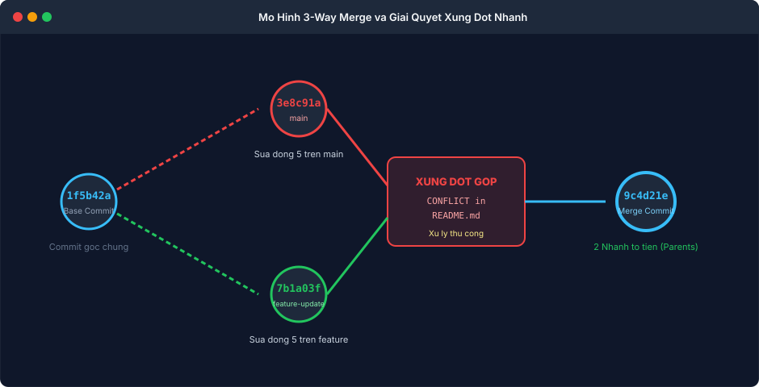

BÀI TẬP 2: QUẢN LÝ NHÁNH VÀ GIẢI QUYẾT XUNG ĐỘT (MERGE CONFLICT)

I. MỤC TIÊU BÀI TẬP

1. Tạo mới và di chuyển linh hoạt giữa các nhánh (branch) cục bộ trong kho lưu trữ Git.
2. Hiểu rõ cơ chế phân kỳ lịch sử (Divergent History) khi hai nhánh cùng phát triển độc lập từ một commit gốc chung.
3. Chủ động tạo ra tình huống xung đột khi gộp nhánh (Merge Conflict) bằng cách chỉnh sửa cùng một dòng nội dung trên cả hai nhánh main và feature-update.
4. Nắm vững kỹ thuật nhận diện, bóc tách và xử lý xung đột thủ công, loại bỏ triệt để các ký hiệu đánh dấu xung đột của Git trước khi hoàn tất commit gộp.
5. Hoàn thành commit gộp nhánh theo cơ chế 3 vùng (3-Way Merge) và phân tích lịch sử trực quan thông qua đồ thị nhánh git log --graph --oneline.


II. BỐI CẢNH VÀ THÔNG SỐ CẤU HÌNH

1. Tên kho lưu trữ: my-project
2. Nhánh chính: main
3. Nhánh phụ phát triển tính năng: feature-update
4. Tệp tin xảy ra xung đột: README.md
5. Commit gốc chung (Base Commit): 1f5b42a
6. Commit trên nhánh main: 3e8c91a
7. Commit trên nhánh feature-update: 7b1a03f
8. Commit hoàn tất gộp nhánh (Merge Commit): 9c4d21e (sở hữu 2 commit tổ tiên)


III. CÁC BƯỚC THỰC HIỆN CHI TIẾT

1. Bước 1: Chuẩn bị tệp tin trên nhánh main ban đầu

Tại nhánh main, tạo nội dung ban đầu cho tệp tin README.md và commit:

```bash
git checkout main
echo "Du an PTIT DevOps - Phien ban khoi tao" > README.md
git add README.md
git commit -m "feat: commit goc khoi tao du an ban dau"
```

2. Bước 2: Tạo nhánh mới feature-update và chỉnh sửa nội dung

Tạo và chuyển sang nhánh tính năng mới bằng lệnh git checkout kèm cờ -b:

```bash
git checkout -b feature-update
```

Chỉnh sửa dòng nội dung trong tệp README.md trên nhánh feature-update:

```bash
echo "Du an PTIT DevOps - Phien ban Beta cap nhat tu nhanh feature" > README.md
git add README.md
git commit -m "feat: cap nhat noi dung tu nhanh feature-update"
```

3. Bước 3: Quay trở lại nhánh main và chỉnh sửa cùng dòng nội dung

Chuyển lại về nhánh main:

```bash
git checkout main
```

Tại nhánh main, thực hiện chỉnh sửa cùng dòng nội dung đó nhưng với thông tin khác để chuẩn bị kịch bản xung đột:

```bash
echo "Du an PTIT DevOps - Phien ban Production cap nhat tu nhanh main" > README.md
git add README.md
git commit -m "docs: cap nhat noi dung truc tiep tren nhanh main"
```

Tại thời điểm này, hai nhánh main và feature-update đã chính thức bị phân kỳ (Divergent) vì cả hai đều có commit mới kể từ commit gốc chung.

4. Bước 4: Thực hiện gộp nhánh và ghi nhận xung đột phát sinh

Đang ở trên nhánh main, thực hiện lệnh gộp nhánh feature-update vào main:

```bash
git merge feature-update
```

Hệ thống thông báo gộp tự động thất bại và xuất hiện xung đột nội dung:

```text
Auto-merging README.md
CONFLICT (content): Merge conflict in README.md
Automatic merge failed; fix conflicts and then commit the result.
```

Kiểm tra trạng thái bằng git status:

```bash
git status
```

Đầu ra ghi nhận tệp README.md đang ở trạng thái both modified (cả hai bên cùng sửa đổi).

5. Bước 5: Phân tích cấu trúc xung đột và xử lý thủ công

Mở tệp README.md bằng trình soạn thảo nano để xem các ký hiệu phân cách xung đột do Git tự động chèn vào:

```bash
nano README.md
```

Cấu trúc xung đột xuất hiện trong tệp bao gồm:
- Dòng bắt đầu bằng 7 ký tự nhỏ hơn kèm chữ HEAD: đại diện cho phiên bản đang có trên nhánh hiện tại (main).
- Dòng phân cách gồm 7 ký tự dấu bằng: phân chia giữa hai phiên bản xung đột.
- Dòng kết thúc bằng 7 ký tự lớn hơn kèm tên nhánh feature-update: đại diện cho phiên bản đến từ nhánh được gộp.

Quy tắc xử lý thủ công:
- Thảo luận và thống nhất nội dung cần giữ lại (ở đây kết hợp thông tin giá trị của cả hai nhánh).
- Xóa bỏ toàn bộ các dòng ký hiệu phân cách của Git.
- Lưu lại tệp với nội dung hòa nhập hoàn chỉnh, mạch lạc.

6. Bước 6: Đưa tệp đã xử lý vào Staging và tạo Merge Commit

Sau khi lưu tệp tin đã sạch các ký hiệu xung đột, tiến hành đánh dấu đã giải quyết xong và commit:

```bash
git add README.md
git commit -m "merge: giai quyet xung dot giua main va feature-update"
```

Lệnh commit này sẽ tạo nên một commit gộp (3-Way Merge Commit) chính thức liên kết hai nhánh lại với nhau.


IV. NỘI DUNG TỆP TIN README SAU KHI GIẢI QUYẾT XUNG ĐỘT HOÀN CHỈNH

Dưới đây là nội dung hoàn chỉnh của tệp README.md sau khi đã dung hợp thành công nội dung của cả hai nhánh:

```text
Du an PTIT DevOps Course - Session 04 Git Fundamentals
Trang thai he thong: Dong bo hop nhat giua Production (main) va Beta Testing (feature-update)
Tac gia thuc hien: Nguyen Van A - PTIT DevOps
Mo ta: Tuan thu quy trinh 3-Way Merge, xu ly xung dot thu cong thanh cong khong de lai ky hieu rac.
```


V. KIỂM TRA VÀ XÁC MINH ĐỒ THỊ NHÁNH

1. Lệnh 1: Kiểm tra trạng thái cây làm việc

```bash
git status
```

Kết quả xác nhận:

```text
On branch main
nothing to commit, working tree clean
```

2. Lệnh 2: Kiểm tra đồ thị nhánh qua git log --graph --oneline

```bash
git log --graph --oneline
```

Đầu ra đồ thị xác nhận cấu trúc rẽ nhánh và hợp nhất chuẩn xác:

```text
o   9c4d21e (HEAD -> main) merge: giai quyet xung dot giua main va feature-update
|\  
| o 7b1a03f (feature-update) feat: cap nhat noi dung tu nhanh feature-update
o | 3e8c91a docs: cap nhat noi dung truc tiep tren nhanh main
|/  
o   1f5b42a feat: commit goc khoi tao du an ban dau
```

3. Lệnh 3: Xem thông tin commit gộp có hai commit cha

```bash
git show --pretty=raw 9c4d21e
```

Phần thông tin header chứng minh commit này có hai dòng parent:
- parent 3e8c91a (đại diện nhánh main)
- parent 7b1a03f (đại diện nhánh feature-update)


VI. HÌNH ẢNH MINH HỌA VÀ NHẬT KÝ THAO TÁC

1. Terminal phát sinh xung đột, xử lý thủ công và đồ thị nhánh


2. Sơ đồ cơ chế gộp 3 vùng (3-Way Merge) và cấu trúc hai commit cha



3. Nhật ký phiên làm việc kiểm tra từ Terminal

```text
devops@workstation:~/project$ git merge feature-update
Auto-merging README.md
CONFLICT (content): Merge conflict in README.md
Automatic merge failed; fix conflicts and then commit the result.
devops@workstation:~/project$ git status
On branch main
You have unmerged paths.
  (fix conflicts and run "git commit")
  (use "git merge --abort" to abort the merge)

Unmerged paths:
  (use "git add <file>..." to mark resolution)
	both modified:   README.md

no changes added to commit (use "git add" to track)
devops@workstation:~/project$ git add README.md
devops@workstation:~/project$ git commit -m "merge: giai quyet xung dot giua main va feature-update"
[main 9c4d21e] merge: giai quyet xung dot giua main va feature-update
devops@workstation:~/project$ git log --graph --oneline
o   9c4d21e (HEAD -> main) merge: giai quyet xung dot giua main va feature-update
|\  
| o 7b1a03f (feature-update) feat: cap nhat noi dung tu nhanh feature-update
o | 3e8c91a docs: cap nhat noi dung truc tiep tren nhanh main
|/  
o   1f5b42a feat: commit goc khoi tao du an ban dau
```


VII. HƯỚNG DẪN NỘP BÀI GITHUB

1. Đường dẫn trên GitHub: homework/session_04/ex2/ (hoặc Session04/BT2/)
2. Cơ chế nộp: Tệp tin README.md đã giải quyết xung đột hoàn chỉnh, kèm theo báo cáo ghi rõ các bước giải quyết xung đột thủ công và hình ảnh hiển thị đồ thị nhánh chạy từ lệnh git log --graph --oneline.


VIII. KẾT LUẬN VÀ BÀI HỌC KINH NGHIỆM

1. Xung đột gộp nhánh (Merge Conflict) không phải là lỗi hệ thống mà là một cơ chế an toàn cốt lõi của Git, được kích hoạt khi có sự thay đổi cạnh tranh trên cùng một vị trí dữ liệu để bảo vệ công sức của các thành viên trong nhóm phát triển.
2. Hiểu rõ cơ chế 3-Way Merge giúp kỹ sư DevOps dễ dàng định vị đâu là commit gốc chung (Base), đâu là thay đổi của nhánh hiện tại (Ours / HEAD), và đâu là thay đổi của nhánh muốn gộp (Theirs).
3. Luôn kiểm tra đồ thị nhánh bằng git log --graph --oneline để xác thực nhánh đã được hợp nhất đúng luồng và cây lịch sử mã nguồn được duy trì trong sạch, minh bạch.
